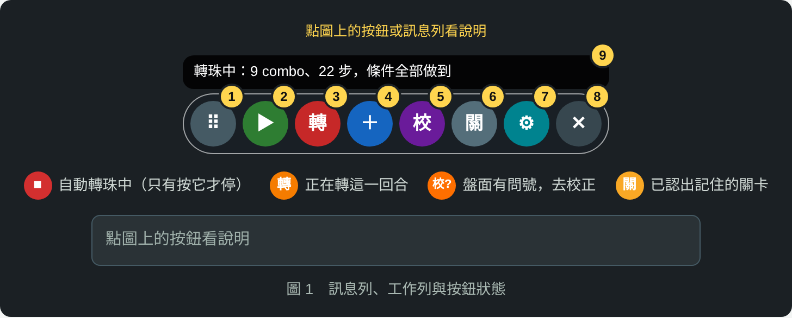
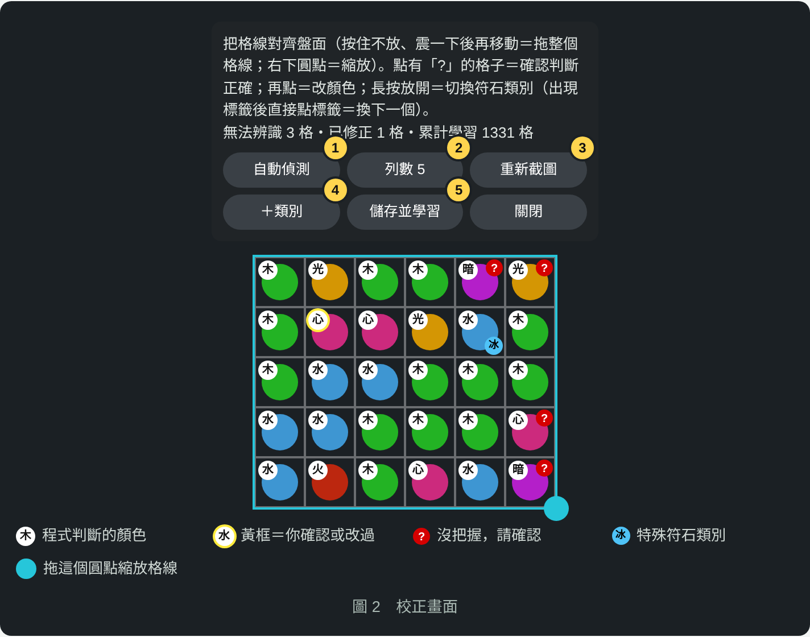
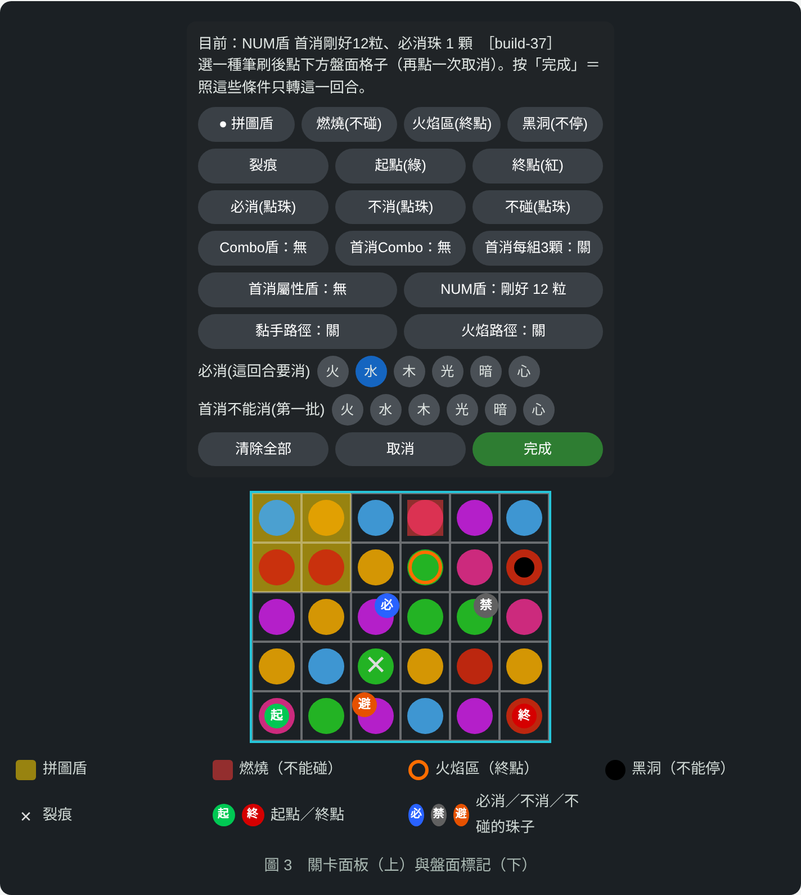
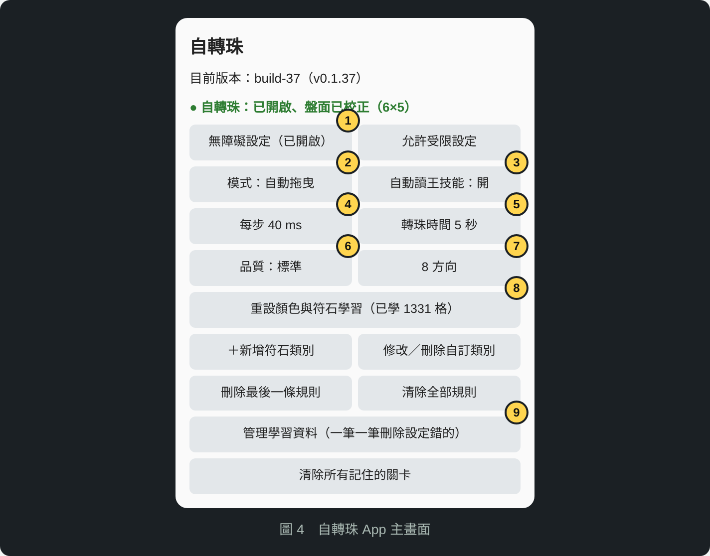

# 自轉珠 操作手冊

自動轉珠：浮動工作列、自動判斷盤面與關卡條件、越玩越準。

**對應版本：build-45（v0.1.45）以上**

> ⚠️ **使用前請注意**：自動操作遊戲可能違反遊戲的使用條款，帳號有被停權的風險，請自行斟酌使用。

目錄：[第一次使用](#第一次使用) ・ [浮動工作列](#浮動工作列) ・ [自動執行](#-自動執行怎麼運作) ・ [校：校正盤面](#校校正盤面) ・ [關：關卡條件](#關關卡條件) ・ [符石類別](#符石類別) ・ [點擊規則](#點擊規則戰鬥外自動操作) ・ [App 設定](#自轉珠-app-設定) ・ [常見問題](#常見問題)

---

## 第一次使用

1. **安裝 APK**。更新時**直接覆蓋安裝**，不要先解除安裝，否則學過的資料會清空。
2. **打開「自轉珠」App**，照畫面引導按「允許受限設定」，再按「開啟無障礙設定」，把自轉珠打開。
3. **進入遊戲的戰鬥**，畫面上方會出現浮動工作列。
4. **按工作列的「校」**，把格線對齊盤面，按「儲存並學習」。
5. **按 ▶** 開始自動執行，或按「**轉**」只轉一回合。

Android 11 以上才能自動截圖、自動轉珠。Android 10 以下只能用 App 裡的「手動模式」。

---

## 浮動工作列

| 編號 | 按鈕 | 功能 |
|---|---|---|
| 1 | ⠿ | **拖曳**移動工作列（位置會記住）。**點一下**收合，只留 ⠿ ▶ ✕，再點一下展開。 |
| 2 | ▶ 自動執行 | 全自動：戰鬥中自己轉珠，戰鬥外照點擊規則自己點。執行中變成紅色 ■，再按一下停止。 |
| 3 | 轉 | 只轉**這一回合**：截圖、判斷盤面、讀 NUM 盾數字、套用記住的關卡條件，轉一次就停。 |
| 4 | ＋ | 新增點擊規則：教程式在戰鬥外自動按哪裡，或看到什麼畫面就停止。 |
| 5 | 校 | 校正盤面：對齊格線、修正認錯的珠子、標記特殊符石，讓程式學起來。 |
| 6 | 關 | 關卡條件：設定這隻王的盾和地形，按「完成」照條件轉一回合。 |
| 7 | ✕ | **連按兩下**（2.5 秒內）關閉自轉珠。要再用，打開自轉珠 App 即可。 |

按鈕顏色變化：

- **紅色 ■**：自動執行中，按一下停止。
- **橘色「轉」**：正在轉這一回合。
- **黃色「關」**：已認出記住的關卡，正在套用它的條件。

---

## ▶ 自動執行怎麼運作

### 戰鬥中，每一回合

1. **等盤面靜止**：連續兩張截圖的盤面一樣。盤面本來就有三連也會照常轉。認不出的格子（問號）在 1/3 以內（6×5 盤 10 格）照樣轉，那些格子當障礙繞開。
2. **判斷關卡**：比對敵人畫面，認出記住的關卡就套用條件，工作列的「關」會變黃色。
3. **沒看過的關卡**：若「自動讀王技能」是開的，程式會長按王打開技能視窗，讀出盾的條件並記住。
4. **讀 NUM 盾數字**：NUM 盾的數字每回合會變，每回合都重新讀。
5. **計算最佳轉法**：在轉珠時間內把路徑用滿，combo 最多、消珠最多，而且符合所有關卡條件。
6. **先在畫面上顯示路徑，再自動拖曳**。

### 條件做不到時：照最接近的轉，不會停住

下面這些情況，程式會跳一行提示，然後**照最接近條件的轉法直接轉**，自動執行也會繼續：

- 這盤找不到完全符合所有關卡條件的轉法，例如 NUM 盾湊不到剛好的粒數，就選最接近的粒數。
- 條件在這盤數學上做不到，例如必消水但盤面水不到 3 顆。
- 自動讀王技能時，有需要你補充的機制（之後可以按「關」補上）。

### 只有這些情況會停下來並震動提醒

- 盤面全部是不能碰的珠子，一步都動不了。
- 看到你設定為「看到就停止」的畫面，例如戰敗、體力不足。
- 按「轉」時一半以上的格子認不出來，通常代表畫面不是戰鬥盤面。

---

## 校：校正盤面

圖中標記：白色圓圈裡的字是程式判斷的顏色；**黃框**＝你確認或改過；**紅色 ?**＝沒把握，請確認；右下角的藍色標籤（例如「冰」）＝特殊符石類別；格線右下角的藍色圓點＝拖它縮放格線。

| 操作 | 效果 |
|---|---|
| **按住不放，震一下後再移動** | 移動整個格線，對齊遊戲的盤面。一按下就滑動不會移動格線，避免點珠子時手指晃到。 |
| 拖右下圓點 | 放大縮小格線。 |
| **點有「?」的珠子** | **確認判斷正確**。同一種顏色、有問號的珠子會**一起確認**，問號全部消失。 |
| 再點一次（或點沒有問號的珠子） | 換顏色：火 → 水 → 木 → 光 → 暗 → 心。每種顏色改一顆，同種的會自動跟著更新。 |
| **長按**珠子再放開 | 切換符石類別：普通 → 強化 → 風化/黏腐 → 觸電 → 冰封/石化 → 起點GO → 自訂類別…，珠子右下角會出現類別標籤。 |
| **點右下角的類別標籤** | 直接換到下一個類別，不用再長按。換回「普通」時標籤消失。 |
| ① 自動偵測 | 自動找盤面位置。 |
| ② 列數 | 切換盤面列數（5、6、7 列等）。 |
| ③ 重新截圖 | 盤面變了（例如動畫播完）時重新截一張。 |
| ④ ＋類別 | 遇到程式不認識的新符石，新增一種類別。 |
| ⑤ 儲存並學習 | 儲存格線位置，並把你確認、修改過的珠子學起來。之後遇到同樣的樣子就會自動認出。 |

畫面上方的「累計學習」是學過的格數，越多越準。

---

## 關：關卡條件

按「關」時，**條件每次都從空白開始**，請照眼前這隻王的盾重新設定。設定好後按 **完成**：程式會記住這一關，並且**照這些條件只轉這一回合**，不會開始連續的自動執行。

> 💡 小技巧：先在遊戲裡**長按王**打開技能視窗，再按「關」，程式會讀出技能文字，自動設定看得懂的條件，例如「五屬傷害盾」會自動把火水木光暗都設成必消；「電擊符石」則靠符石辨識（先在「校」把電擊符石標成「觸電」）。

### 筆刷：點盤面上的格子

先點一支筆刷，再點下方盤面的格子；再點一次同一格就取消。

| 筆刷 | 意思 | 標記會不會記住 |
|---|---|---|
| 拼圖盾（黃色） | 標出盾的形狀。第一批要用同一種顏色把這些格子全部消掉。 | 記住（同一關形狀固定） |
| 燃燒(不碰)（紅色方塊） | 這些**位置**不能經過（燃燒、地獄火、雷射等地形）。 | 記住 |
| 火焰區(終點)（橘色圓圈） | 最後一步必須停在其中一格。 | 記住 |
| 黑洞(不停)（黑色圓點） | 最後一步不能停在這格。 | 記住 |
| 裂痕（✕） | 回合結束時停在這個**位置**的珠子不能被消除。可以經過，跟珠子種類無關。 | 記住 |
| 起點(綠)／終點(紅) | 綠紅漩渦：一定要從綠格出發、停在紅格。 | 記住 |
| 必消(點珠)（藍色「必」） | 點到的**這顆珠**這回合一定要消掉。就算程式沒把握它的顏色，也會照最可能的顏色去消；它本來不能碰（例如觸電）的話，就不碰它、靠旁邊湊三連消掉。 | **只用這一回合** |
| 不消(點珠)（灰色「禁」） | 點到的**這顆珠**這回合不能消。 | **只用這一回合** |
| 不碰(點珠)（橘色「避」） | 點到的**這顆珠**不能碰：路徑不能經過、不能從它開始。它還是可以被旁邊的珠子湊成三連消掉。 | **只用這一回合** |

### 盾與條件按鈕

每按一下換一個數值，最後會回到「無」。可以同時設定好幾個條件，程式會找**全部都符合**的轉法；這盤做不到時，照最接近條件的轉法轉。

| 按鈕 | 意思 | 可選數值 |
|---|---|---|
| Combo盾 | 整回合（含疊珠）至少 X combo。 | 5～12 |
| 首消Combo | 第一批**剛好** X combo。 | 1～10 |
| 首消每組3顆 | 第一批每一組都只能剛好 3 顆，不能有 4 顆以上連成一組。設定首消Combo 時自動打開，可手動關掉。 | 開／關 |
| 首消屬性盾 | 第一批至少 X 組屬性符石（心珠不算）。 | 4～8 |
| NUM盾 | 第一批消除**剛好** X 粒符石，疊珠不算。敵人身上顯示「NUM 數字」。 | 10～20 |
| 黏手路徑 | 碰過的格子不能再碰（路徑不能重複）。 | 開／關 |
| 火焰路徑 | 不要重踩剛走過的格子。 | 開／關 |
| 必消(這回合要消) | 點選的顏色，這回合每種都要消到至少一組（多屬性盾，例如水火盾）。 | 點顏色開關 |
| 首消不能消(第一批) | 點選的顏色，第一批不能消（例如「水連擊零化」）。疊珠不算。 | 點顏色開關 |

> 📌 **NUM 盾的數字每回合會變**（例如 15 → 12 → 6）。按 ▶ 或「轉」時，程式每回合會自己讀敵人身上的數字，並顯示「讀到 NUM 盾：首消剛好 12 粒」。按「關」→「完成」則照你手動設定的數字。

### 下方三顆按鈕

- **清除全部**：把面板上的設定全部清空。
- **取消**：不儲存，關閉面板。
- **完成**：記住這一關的條件，並照條件轉這一回合。點珠標記只用這一回合，不會記住。

### 範例

1. 敵人顯示「NUM 12」，並要求消水：按 **關**。
2. 「NUM盾」按到「剛好 12 粒」。
3. 「必消(這回合要消)」點 **水**。
4. 按 **完成**：程式轉一次，第一批剛好消 12 粒，而且有消到水。

---

## 符石類別

在校正畫面**長按**珠子切換類別（出現標籤後，直接點標籤換下一個），按「儲存並學習」後，之後看到同樣的樣子會自動認出。

| 類別（標籤） | 能不能碰 | 消除方式 | 例子 |
|---|---|---|---|
| 普通 | 可以 | 照常消除 | 一般珠、種族符石 |
| 強化（強） | 可以 | 照常消除 | 強化符石 |
| 風化/黏腐（風） | 不能 | 盡量消除 | 風化、黏腐 |
| 觸電（電） | 不能 | 必須消除 | 觸電 |
| 冰封/石化（冰） | 不能 | 不能消除 | 冰封、石化、凍結 |
| 起點GO（GO） | 可以 | 照常消除，**一定要從這顆開始轉** | GO 符石 |

### 新增自訂類別

遇到程式不認識的新符石：校正畫面按「＋類別」，或在 App 按「＋新增符石類別」。要設定：

- **名稱**：例如「刺血符石」。
- **能不能碰**：可以碰／不能碰（碰到會停止或受傷）。
- **消除方式**：照常消除、必須消除、盡量消除、盡量不要消除、不能消除。
- 可勾選「**必須從這顆開始轉**」（像 GO 符石）。

新增後，在校正畫面長按那顆珠子選這個類別，再按「儲存並學習」。設定錯了可以在 App 的「修改／刪除自訂類別」修改或刪除。

---

## ＋：點擊規則（戰鬥外自動操作）

自動執行時，戰鬥外的畫面（結算、再次挑戰、確認視窗）要靠點擊規則才會自動過。

1. 停在要自動處理的畫面，按工作列的 **＋**。
2. 選模式：**看到就點**（例如「再次挑戰」「確定」「出戰」），或**看到就停止**（例如「戰敗」「體力不足」）。
3. 點一下畫面上的那個位置。之後出現一樣的畫面，自動執行就會幫你點，或停止並震動提醒。

規則可以在 App 裡「刪除最後一條規則」「清除全部規則」，或在「管理學習資料」一條一條刪除。

---

## 自轉珠 App 設定

| 編號 | 設定 | 說明 |
|---|---|---|
| 1 | 無障礙設定／允許受限設定 | 第一次使用時開啟權限，程式會帶你跳到正確的設定頁並提示要按哪裡。 |
| 2 | 模式 | 自動拖曳：自己轉。只顯示路徑：只在畫面上畫出路徑，你自己轉。 |
| 3 | 自動讀王技能 | 遇到沒看過的關卡，自動長按王讀取技能並設定條件。 |
| 4 | 每步 | 每移動一格的時間，預設 40 ms（最快）。轉出來跟預覽路徑不一樣（漏格、跑錯格）時，改成 50 或 70。 |
| 5 | 轉珠時間 | 遊戲允許的轉珠秒數。程式會把路徑長度用滿這段時間，並保留 0.4 秒緩衝。 |
| 6 | 品質 | 標準或高。高品質找得更好但計算較慢；常破不了的關卡會自動提高。 |
| 7 | 方向 | 8 方向（含斜轉）或 4 方向（只有上下左右）。 |
| 8 | 重設顏色與符石學習 | 清掉所有學過的顏色和符石樣子，從頭開始。 |
| 9 | 管理學習資料 | 一筆一筆刪除設定錯的資料：顏色範例、特殊符石樣子、記住的關卡、點擊規則。 |

App 下方另有**手動模式**：自己排盤面（可選 6×5、6×6 等），按「求解」看最佳路徑，按「播放路徑」看動畫。

---

## 常見問題

**按 ▶ 不會轉？**
- 認不出的格子太多（超過 1/3）：按「校」，點問號確認或修正，再按「儲存並學習」。
- 盤面還在動（落珠動畫）：等一下，程式要連續兩張截圖一樣才會轉。
- 格線沒對齊：按「校」重新對齊。

**轉出來的路徑跟預覽不一樣？**
手機跟不上速度。到 App 把「每步」改成 50 或 70 ms，路徑長度會自動調整。

**怎麼確認裝的是最新版？**
App 首頁、遊戲中的啟動提示、「關」面板第一行都會顯示 build 號碼。下載時請用帶號碼的檔名，例如 `tos-orb-solver-37.apk`，避免開到舊檔。

**學過的資料不見了？**
更新時先解除安裝會清空資料。之後請直接安裝新版覆蓋。

**設定錯了怎麼辦？**
App →「管理學習資料」，找到那一筆刪除。自訂類別在「修改／刪除自訂類別」。
